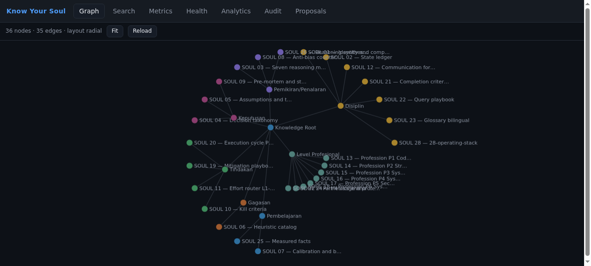
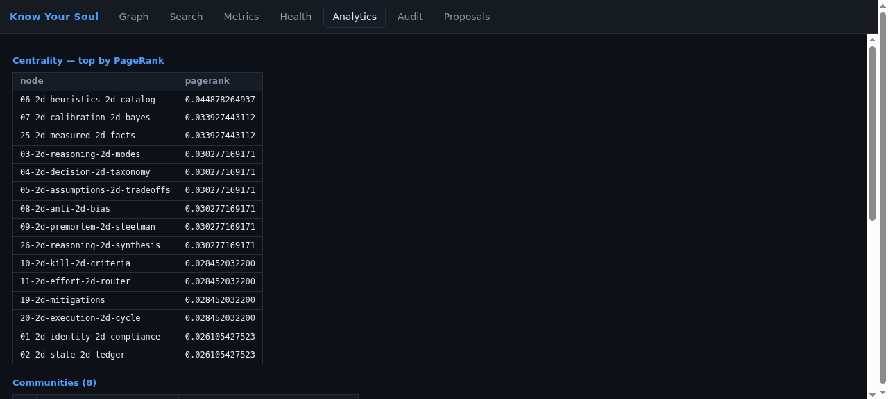

<div align="center">

[🇬🇧 English](README.md) | **🇮🇩 Bahasa Indonesia**

# Know Your Context

**Konteks untuk agent, dibangun di atas tiga pilar — pengetahuan multi-modal, kecerdasan kode deterministik, dan memori teraudit. Semua lokal. Tanpa model di dalam.**

[](https://github.com/Sigit-AP/know-your-context/actions/workflows/ci.yml)
[](https://pypi.org/project/know-your-context/)
[](https://www.python.org/)
[](LICENSE)

</div>

## Daftar Isi

- [Kenapa](#kenapa)
- [Instalasi](#instalasi)
- [Mulai Cepat](#mulai-cepat)
- [Benchmark](#benchmark)
- [Fitur Utama](#fitur-utama)
- [Web View](#web-view)
- [Cara Kerja](#cara-kerja)
- [Referensi CLI](#referensi-cli)
- [MCP Tools](#mcp-tools)
- [Konfigurasi](#konfigurasi)
- [Keamanan](#keamanan)
- [Development](#development)
- [Kontribusi](#kontribusi)
- [Lisensi](#lisensi)

## Kenapa

Agent membaca ulang dokumen yang sama di setiap sesi dan membayar harga token
penuh untuk itu. Lebih buruk lagi, apa yang dipelajari agent hari ini hilang
besok — tidak ada yang dinilai, berversi, atau teraudit.

Know Your Context adalah memori yang memperbaiki keduanya. Ia menjawab dari graph
lokal, bukan dari korpus mentah (**terukur: 466× lebih sedikit token pada korpus
campuran 52 file**), setiap jawaban membawa provenance dan id audit, dan setiap
perubahan graph melewati proposal yang kamu setujui — dengan rollback byte-exact.

Batasannya keras dan ditegakkan saat runtime: tidak ada model, embedding, atau
panggilan provider di dalam. AI tetap di sisi agent. Ini bagian yang tidak
pernah menebak.

> Agent dengan model vision tidak dikunci keluar: mereka membaca gambar atau
> PDF hasil scan di sisi mereka, lalu men-submit hasil ekstraksi lewat kontrak
> `submit_extraction` — terikat hash file sumber, bertanda `agent-extracted`,
> digate oleh review. Produknya sendiri tidak pernah memanggil model.

Know Your Context memberi agent konteksnya dari tiga pilar:

- **Knowledge** — pengetahuan multi-modal lintas domain: markdown, PDF,
  teks biasa, dan gambar atau dokumen hasil scan lewat ekstraksi agent
  eksternal (kontrak `submit_extraction`).
- **Code intelligence** — pemahaman kode deterministik: ekstraksi AST,
  symbol lookup, call hierarchy, lintas 19 bahasa.
- **Auditable memory** — memori pembelajaran yang deterministik, ternilai,
  berversi, dan rollback-exact. Pilar ini milik kita; belum ada yang lain
  mengirimkannya.

## Instalasi

**Butuh:** Python 3.14

```bash
pip install know-your-context
```

Dari source:

```bash
git clone https://github.com/Sigit-AP/know-your-context.git
cd know-your-context
uv sync --frozen
```

Kernel ekstraksi Rust bersifat opsional. Instalasi tanpa toolchain Rust otomatis
fallback ke extractor Python — kedua engine menghasilkan graph yang byte-identik
(dibuktikan oleh test).

## Mulai Cepat

```bash
# catat pengetahuan (teraudit, ternilai)
know-your-context --store demo.sqlite3 log-event \
  '{"node_id":"n1","parent_id":"p1-root","domain":"P1",
    "summary":"Selalu verifikasi sebelum mengklaim selesai",
    "provenance":["context://demo"],"source_version_id":"demo-v1"}'

know-your-context --store demo.sqlite3 rebuild
know-your-context --store demo.sqlite3 query \
  '{"purpose":"verify before claiming done","token_budget":400}'

# ingest kode dan dokumen (proposal-only, kontrak v3)
know-your-context ingest-directory ./my-project
know-your-context watch ./my-project --interval 2

# lihat semuanya
know-your-context webview                 # web view interaktif, loopback + token
know-your-context serve --daemon          # superpower server 50-agent
know-your-context report                  # god nodes, koneksi mengejutkan, pertanyaan
know-your-context diagnose                # 11 self-check, exit code mencerminkan kesehatan
```

## Benchmark

Semua angka berasal dari suite benchmark yang ter-commit dan reproduksibel di
`bench/`. Jalankan sendiri; setiap suite deterministik dan offline.

**Reduksi token** (`bench/tokens/`, korpus campuran ter-pin, estimator beku):

| Ukuran korpus | File | Token mentah | Token per jawaban | Reduksi | Cakupan rubric |
|---|---|---|---|---|---|
| Kecil | 6 | 8.940 | 321 | 27,9× | 100% |
| Sedang | 26 | 62.442 | 320 | 195,4× | 87% |
| Besar | 52 | 151.606 | 325 | **466,4×** | 97% |

**Retrieval memori** (`bench/memory/`, dataset LOCOMO asli, 5.882 turn /
1.982 pertanyaan): recall@10 = **0,5433** diukur pada produk apa adanya.

**Retrieval kode pada repo nyata** (`bench/codebase/`, psf/requests + chalk +
tree-sitter-python ter-pin): symbol lookup **15/15 top-1**, call hierarchy
**7/7 eksak** terhadap ground truth terverifikasi manual, nol kegagalan ekstraksi.

**Beban multi-agent** (50 agent, 16 operasi campuran, terukur): group commit
menaikkan throughput tulis **7,04×**, spammer 10× hanya memangkas 14,2%
throughput agent sopan, kill -9 di tengah burst kehilangan **nol** tulisan yang
ter-ack.

**Algoritma graph** (`bench/institutional/`, gaya GAPBS/LDBC-Graphalytics):
**8/8 kernel lolos** kebenaran terhadap implementasi referensi.

## Fitur Utama

**Deterministik menyeluruh.** Input sama, byte sama, setiap run — di dua engine
ekstraksi (Rust + Python), lintas proses, lintas hash seed. Kalau angkanya
berubah, inputnya yang berubah.

**Ingestion pengetahuan.** Markdown structure-aware, text layer PDF, dan teks
biasa. PDF hasil scan ditandai jujur (`no_text_layer`), tidak dipalsukan, dan
agent dengan model vision men-submit ekstraksi gambar/scan lewat
`submit_extraction` — terikat hash, digate review, tidak pernah auto-promote.

**Code intelligence.** Sembilan belas bahasa pemrograman via tree-sitter:
kernel Rust di jalur panas dan fallback Python byte-identik menutup sisanya.
Symbol lookup FTS5, call hierarchy, dan retrieval berbudget token di atas
graph yang dihasilkan.

**Hierarki yang mengenal dirinya.** Node primary memegang tanggung jawab
tunggal, turun ke kedalaman arbitrer, dan terhubung ke primary lain lewat
bridge. Graph memberitahumu kapan subtree anak butuh perbaikan — sebagai
proposal, tidak pernah menulis ulang diam-diam.

**Ekstraksi eksternal, bertingkat jujur.** Agent men-submit ekstraksi
vision/LLM lewat `submit_extraction`: terikat sha256 file sumber, bertanda
`agent-extracted` dengan plafon confidence lebih rendah, dikoroborasi atau
dikontradiksi agent lain, dan tidak pernah dipromosikan tanpa persetujuan.

**Superpower server.** Satu daemon detached per store melayani hingga 50 agent:
read pool di atas snapshot WAL, writer tunggal dengan group commit, token bucket
per-agent, jalur weighted-fair-queuing, session lease, graceful drain, dan stop
bereskalasi (graceful → forced → SIGKILL + pembersihan artifak).

**Analitik dan laporan.** PageRank, HITS, Katz, Louvain, cycles, bridges, skor
kesehatan — plus laporan komposit (god nodes, koneksi mengejutkan dengan
penjelasan terstruktur, suggested questions yang terbukti bisa dijawab).

**Dua belas format ekspor.** DOT, Mermaid, CSV, GraphML, GEXF, Cytoscape, D3,
SVG, TGF, adjacency, dan buku markdown per domain — semuanya ter-hash ke dalam
manifest generasi.

## Web View

`know-your-context webview` menjalankan viewer loopback-only (token di URL, cookie
sesi setelah load pertama, anti DNS-rebinding, tanpa CORS). Tujuh tab:

<p align="center">
  
</p>

| Tab | Isinya |
|---|---|
| Graph | Kanvas interaktif — pan/zoom/klik untuk detail node (skor, provenance) |
| Search | Pencarian simbol FTS5 dengan filter `kind:`/`lang:` |
| Metrics | Hitungan store, latensi per operasi, kapasitas publish, skor kesehatan |
| Health | 11 self-check fail-closed dengan severity |
| Analytics | Centrality, communities, bridges atas graph live |
| Audit | Log event berantai-hash, teredaksi |
| Proposals | Antrian review: saran split, antrian ekstraksi, sinyal review |

<p align="center">
  
</p>

## Cara Kerja

```
sumber (kode, dokumen, pengetahuan) ──▶ extractor (kernel Rust / fallback Python)
                                        │  deterministik, terbatas, fail-closed
                                        ▼
                          event store SQLite (append-only, berantai-hash)
                                        │  schema v4, WAL
                                        ▼
                  proyeksi (read model) ──▶ retrieval + analitik + ekspor
                                        │
              superpower server: 50 agent, jalur, kuota, group commit
```

Tulisan tidak pernah langsung masuk ke graph. Ia mendarat sebagai event
teraudit, menjadi proposal, dan di-apply lewat alur operator-gated. Rollback
memulihkan hash dan skor persis seperti sebelum apply.

## Referensi CLI

| Perintah | Fungsi |
|---|---|
| `query` / `get-node` / `get-subtree` | Baca graph pengetahuan (berbatas token) |
| `path` / `explain` / `affected` / `god-nodes` | Verb traversal dan analisis |
| `log-event` / `record-outcome` / `evaluate` / `review` | Siklus tulis + penilaian |
| `propose-improvement` / `apply-improvement` / `rollback` | Alur mutasi ter-gate |
| `ingest-file` / `ingest-directory` / `ingest` | Ingestion kode/dokumen (kontrak v3, proposal-only) |
| `submit-extraction` / `extraction review\|approve\|reject` | Ekstraksi agent eksternal (kontrak v4) |
| `watch` | Watcher polling, re-ingestion incremental |
| `export` / `analytics` / `report` | Format, metrik dalam, laporan komposit |
| `serve --daemon\|--proxy\|--socket\|--http` | Superpower server + adapter |
| `webview` | Web view interaktif |
| `config` / `metrics` / `diagnose` | Tooling ops (konfigurasi berlapis, metrik, self-check) |
| `backup` / `restore` / `relearn-scan` / `relearn-apply` | Durabilitas dan alur relearn |

## MCP Tools

MCP server mengekspos empat belas operasi knowledge beku (`knowledge_query`,
`knowledge_get_node`, … sampai `knowledge_god_nodes`) plus
`knowledge_ingest_file`, `knowledge_ingest_directory` (v3), dan
`knowledge_submit_extraction` (v4). Setup dengan Hermes:
[docs/integration/hermes.md](docs/integration/hermes.md).

## Konfigurasi

Berlapis: defaults → file TOML → environment variable (`KNOW_YOUR_CONTEXT_*`) →
flag CLI. `config describe` mencetak setiap key dengan provenance-nya; secret
teredaksi di semua permukaan. Kill switch tersedia untuk setiap optimasi
(`KNOW_YOUR_CONTEXT_NO_GROUP_COMMIT`, `KYS_DISABLE_RUST_KERNEL`, …).

## Keamanan

- Batas no-AI ditegakkan saat runtime: paket provider/vector gagal-tertutup,
  socket keluar ditolak, dan MCP server menolak start bila menemukan kredensial
  provider di environment-nya.
- Host allowlist di setiap request, perbandingan key dalam waktu konstan, body
  dibatasi, secret teredaksi, path terkurung.
- CI menjalankan bandit dan pip-audit sebagai gate blocking di setiap push.

## Development

```bash
uv sync --frozen
uv run pytest -q                 # 6.830 test
uv run pyright
uv run ruff check
uv run python bench/run.py run   # 24/24 diterima
```

Kernel Rust opsional dibangun dengan [maturin](https://maturin.rs):
`maturin build --release -m kernel-rust/Cargo.toml`.

CI menjalankan gate yang sama di Ubuntu dan macOS, plus bandit, pip-audit, dan
penjaga atribusi lisensi.

<details>
<summary>Kontribusi</summary>

Issue dan pull request diterima. Jalankan seluruh gate dulu. Jangan pernah
menambah dependensi model atau provider — penjaga runtime gagal-tertutup.
Perubahan perilaku kontrak beku hanya lewat versi kontrak baru.

</details>

## Lisensi

[Apache 2.0](LICENSE). Atribusi di [NOTICE](NOTICE).
