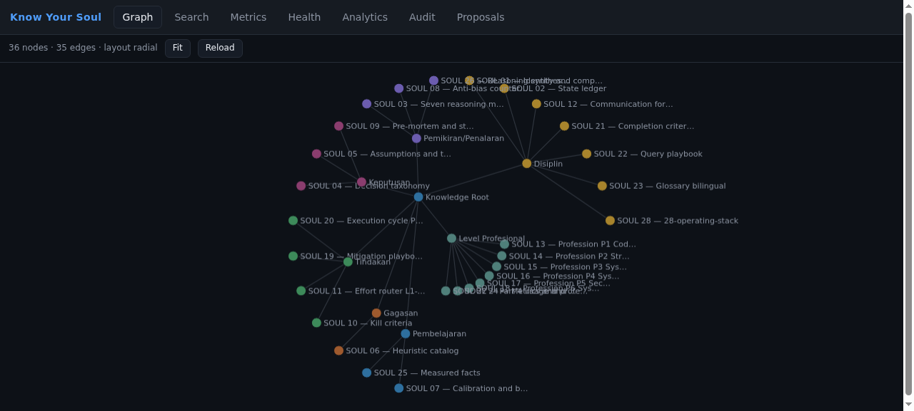
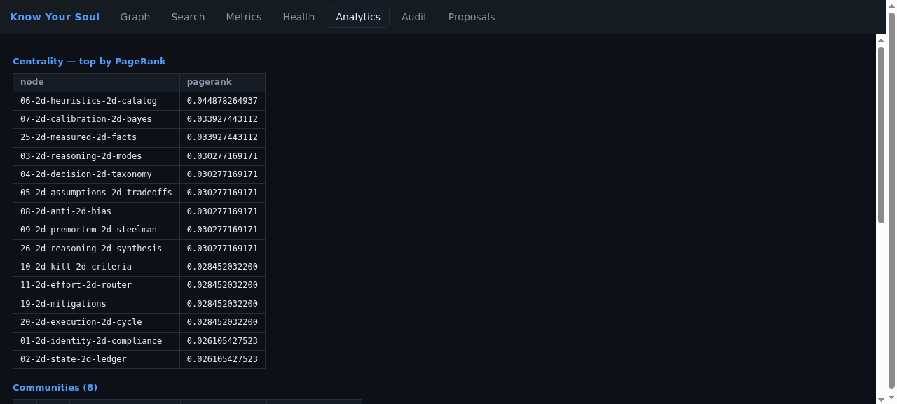

<div align="center">

**🇬🇧 English** | [🇮🇩 Bahasa Indonesia](README.id.md)

# Know Your Context

**Context for agents, built on three pillars — multi-modal knowledge, deterministic code intelligence, and auditable memory. All local. No model inside.**

[](https://github.com/Sigit-AP/know-your-context/actions/workflows/ci.yml)
[](https://pypi.org/project/know-your-context/)
[](https://www.python.org/)
[](LICENSE)

</div>

## Contents

- [Why](#why)
- [Install](#install)
- [Quickstart](#quickstart)
- [Benchmarks](#benchmarks)
- [Key Features](#key-features)
- [The Web View](#the-web-view)
- [How It Works](#how-it-works)
- [CLI Reference](#cli-reference)
- [MCP Tools](#mcp-tools)
- [Configuration](#configuration)
- [Security](#security)
- [Development](#development)
- [Contributing](#contributing)
- [License](#license)

## Why

Agents re-read the same documents every session and pay full token price for
it. Worse, what an agent learns today is gone tomorrow — nothing is scored,
versioned, or auditable.

Know Your Context is the memory that fixes both. It answers from a local graph
instead of the raw corpus (**measured: 466× fewer tokens on a 52-file mixed
corpus**), every answer carries provenance and an audit id, and the store
behaves like a disk — writes land immediately and pass a mandatory,
deterministic post-write auto-review, with byte-exact rollback.

The boundary is hard and enforced at runtime: no model, no embeddings, no
provider calls inside. The AI stays on the agent side. This is the part that
never guesses.

> Agents with vision models are not locked out: they read images or scanned
> PDFs on their side, then submit the extraction through the `submit_extraction`
> contract — hash-bound to the source file, tagged `agent-extracted`, screened
> by the deterministic auto-review. The product itself never calls a model.

Know Your Context gives an agent its context from three pillars:

- **Knowledge** — multi-modal knowledge across domains: markdown,
  PDFs, plain text, and images or scanned documents via external-agent
  extraction (the `submit_extraction` contract).
- **Code intelligence** — deterministic code understanding: AST extraction,
  symbol lookup, call hierarchy, across 19 languages.
- **Auditable memory** — a learning memory that is deterministic, scored,
  versioned, and rollback-exact. This pillar is ours; nobody else ships it.

## Install

**Requires:** Python 3.14

```bash
pip install know-your-context
```

From source:

```bash
git clone https://github.com/Sigit-AP/know-your-context.git
cd know-your-context
uv sync --frozen
```

The Rust extraction kernel is optional. Installations without a Rust toolchain
fall back to the Python extractor automatically — the two engines produce
byte-identical graphs (verified by test).

## Quickstart

```bash
# record knowledge (audited, scored)
know-your-context --store demo.sqlite3 log-event \
  '{"node_id":"n1","parent_id":"p1-root","domain":"P1",
    "summary":"Always verify before claiming done",
    "provenance":["context://demo"],"source_version_id":"demo-v1"}'

know-your-context --store demo.sqlite3 rebuild
know-your-context --store demo.sqlite3 query \
  '{"purpose":"verify before claiming done","token_budget":400}'

# ingest code and documents (disk-mode writes, contracts v3/v5)
know-your-context ingest-directory ./my-project
know-your-context watch ./my-project --interval 2

# see everything
know-your-context webview                 # interactive web view, loopback + token
know-your-context serve --daemon          # 50-agent superpower server
know-your-context report                  # god nodes, surprising connections, questions
know-your-context diagnose                # 11 self-checks, exit code reflects health
```

## Benchmarks

All numbers come from committed, reproducible benchmark suites in `bench/`.
Run them yourself; every suite is deterministic and offline.

**Token reduction** (`bench/tokens/`, pinned mixed corpus, frozen estimator):

| Corpus size | Files | Raw tokens | Tokens per answer | Reduction | Rubric coverage |
|---|---|---|---|---|---|
| Small | 6 | 8,940 | 321 | 27.9× | 100% |
| Medium | 26 | 62,442 | 320 | 195.4× | 87% |
| Large | 52 | 151,606 | 325 | **466.4×** | 97% |

**Memory retrieval** (`bench/memory/`, real LOCOMO dataset, 5,882 turns /
1,982 questions): recall@10 = **0.5433** measured on the product as-is.

**Code retrieval on real repositories** (`bench/codebase/`, pinned
psf/requests + chalk + tree-sitter-python): symbol lookup **15/15 top-1**,
call hierarchy **7/7 exact** against manually verified ground truth, zero
extraction failures.

**Multi-agent load** (50 agents, 16 operations mixed, measured): group commit
raises write throughput **7.04×**, a spammer at 10× costs polite agents only
14.2% throughput, kill -9 mid-burst loses **zero** acknowledged writes.

**Graph algorithms** (`bench/institutional/`, GAPBS/LDBC-Graphalytics style):
**8/8 kernels pass** correctness against reference implementations.

## Key Features

**Deterministic everything.** Same input, same bytes, every run — across two
extraction engines (Rust + Python), across processes, across hash seeds. If a
number changes, the input changed.

**Knowledge ingestion.** Structure-aware markdown, PDF text layers, and plain
text. Scanned PDFs are flagged honestly (`no_text_layer`) instead of being
faked, and agents with vision models submit image/scanned extractions through
`submit_extraction` — hash-bound, auto-reviewed, capped at the
`agent-extracted` tier.

**Code intelligence.** Nineteen programming languages via tree-sitter: a Rust
kernel does the hot path and a byte-identical Python fallback covers the rest.
FTS5 symbol lookup, call hierarchy, and token-budgeted retrieval over the
resulting graph.

**A hierarchy that knows itself.** Primary nodes hold single responsibilities,
descend to arbitrary depth, and connect to other primaries through bridges.
The graph tells you when a child subtree needs improvement — as a proposal,
never a silent rewrite.

**Disk-mode writes, auto-reviewed.** Writes land immediately — no approval
queue. Every change passes a mandatory post-write auto-review (contract v5):
a round-trip verify plus a deterministic scan for prompt injection, secrets,
and active markup. A reject is compensated append-only; the verdicts journal
in the audit trail. The legacy approval flow returns with
`KNOW_YOUR_CONTEXT_MANUAL_GATES=1`.

**External extraction, honestly tiered.** Agents submit vision/LLM extractions
through `submit_extraction`: bound to the source file's sha256, tagged
`agent-extracted` with a lower confidence ceiling, and corroborated or
contradicted by other agents.

**Superpower server.** One detached daemon per store serves up to 50 agents:
a read pool on WAL snapshots, a single writer with group commit, per-agent
token buckets, weighted-fair-queuing lanes, session leases, graceful drain,
and an escalating stop (graceful → forced → SIGKILL + artifact cleanup).

**Analytics and reports.** PageRank, HITS, Katz, Louvain, cycles, bridges,
health scores — plus a composite report (god nodes, surprising connections
with structured explanations, suggested questions that are proven answerable).

**Twelve export formats.** DOT, Mermaid, CSV, GraphML, GEXF, Cytoscape, D3,
SVG, TGF, adjacency, and a per-domain markdown book — all hashed into the
generation manifest.

## The Web View

`know-your-context webview` starts a loopback-only viewer (token in URL, session
cookie after first load, anti-DNS-rebinding, no CORS). Seven tabs:

<p align="center">
  
</p>

| Tab | What it shows |
|---|---|
| Graph | Interactive canvas — pan/zoom/click for node detail (scores, provenance) |
| Search | FTS5 symbol search with `kind:`/`lang:` filters |
| Metrics | Store counts, per-operation latency, publish capacity, health score |
| Health | 11 fail-closed self-checks with severity |
| Analytics | Centrality, communities, bridges over the live graph |
| Audit | The hash-chained event log, redacted |
| Proposals | Auto-review journal: pass/reject verdicts, split suggestions, review signals |

<p align="center">
  
</p>

## How It Works

```
sources (code, docs, knowledge) ──▶ extractors (Rust kernel / Python fallback)
                                        │  deterministic, capped, fail-closed
                                        ▼
                          SQLite event store (append-only, hash-chained)
                                        │  schema v4, WAL
                                        ▼
                  projection (read model) ──▶ retrieval + analytics + exports
                                        │
              superpower server: 50 agents, lanes, quotas, group commit
```

Writes land immediately as audited events (disk-mode, contract v5). A
mandatory post-write auto-review verifies every change — a round-trip read-back
plus a deterministic injection/secret/active-markup scan; a reject is
compensated append-only. Rollback restores exact pre-apply hashes and scores.
The legacy proposal/approval flow stays available under
`KNOW_YOUR_CONTEXT_MANUAL_GATES=1`.

## CLI Reference

| Command | What it does |
|---|---|
| `query` / `get-node` / `get-subtree` | Read the knowledge graph (token-bounded) |
| `path` / `explain` / `affected` / `god-nodes` | Traversal and analysis verbs |
| `log-event` / `record-outcome` / `evaluate` / `review` | Write + scoring lifecycle |
| `propose-improvement` / `apply-improvement` / `rollback` | Mutation + rollback flow |
| `ingest-file` / `ingest-directory` / `ingest` | Code/document ingestion (contracts v3/v5, disk-mode) |
| `submit-extraction` / `extraction review\|approve\|reject` | External agent extraction (contracts v4/v5) |
| `watch` | Polling watcher, incremental re-ingestion |
| `export` / `analytics` / `report` | Formats, deep metrics, composite report |
| `serve --daemon\|--proxy\|--socket\|--http` | Superpower server + adapters |
| `webview` | Interactive web view |
| `config` / `metrics` / `diagnose` | Ops tooling (layered config, metrics, self-checks) |
| `backup` / `restore` / `relearn-scan` / `relearn-apply` | Durability and relearn flow |

## MCP Tools

The MCP server exposes the fourteen frozen knowledge operations
(`knowledge_query`, `knowledge_get_node`, … through `knowledge_god_nodes`)
plus `knowledge_ingest_file`, `knowledge_ingest_directory` (v3), and
`knowledge_submit_extraction` (v4). Setup with Hermes:
[docs/integration/hermes.md](docs/integration/hermes.md).

## Configuration

Layered: defaults → TOML file → environment variables (`KNOW_YOUR_CONTEXT_*`) →
CLI flags. `config describe` prints every key with its provenance; secrets are
redacted on every surface. Kill switches exist for every optimization
(`KNOW_YOUR_CONTEXT_NO_GROUP_COMMIT`, `KYS_DISABLE_RUST_KERNEL`, …).
`KNOW_YOUR_CONTEXT_MANUAL_GATES=1` restores the legacy approval-gated write
flow (contract v4); the default is disk-mode (contract v5).

## Security

- The no-AI boundary is enforced at runtime: provider/vector packages fail
  closed, outbound sockets are denied, and the MCP server refuses to start
  when provider credentials exist in its environment.
- Host allowlist on every request, constant-time key comparison, capped
  bodies, redacted secrets, contained paths.
- CI runs bandit and pip-audit as blocking gates on every push.

## Development

```bash
uv sync --frozen
uv run pytest -q                 # 6,830 tests
uv run pyright
uv run ruff check
uv run python bench/run.py run   # 24/24 accepted
```

The optional Rust kernel builds with [maturin](https://maturin.rs):
`maturin build --release -m kernel-rust/Cargo.toml`.

CI runs the same gates on Ubuntu and macOS, plus bandit, pip-audit, and a
license-attribution guard.

<details>
<summary>Contributing</summary>

Issues and pull requests welcome. Run the full gate suite first. Never add a
model or provider dependency — the runtime guards fail closed. Frozen-contract
behavior changes only with a new contract version.

</details>

## License

[Apache 2.0](LICENSE). Attribution in [NOTICE](NOTICE).
